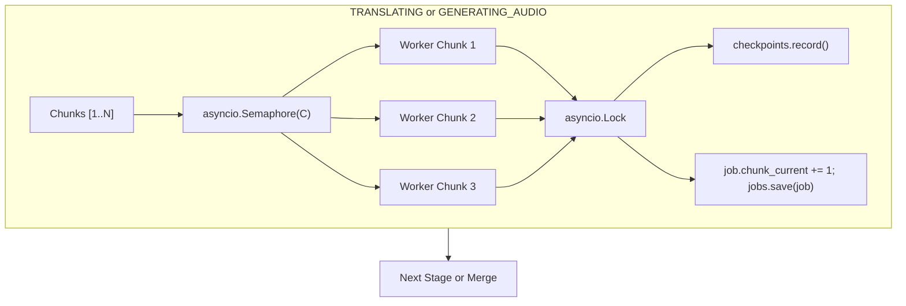

# Parallel Chunk Processing Design

## Overview
Process pipeline chunks concurrently within stages (`TRANSLATING`, `PREPARING_TTS`, and `GENERATING_AUDIO`) using bounded concurrency (`asyncio.Semaphore`), thread/async-safe checkpoint recording (`asyncio.Lock`), and monotonic progress tracking.

---

## 1. Problem Statement
Currently, `PipelineOrchestrator` processes chunks sequentially using synchronous `for chunk in chunks:` loops:
- `_translate_chunks`: Translates chunks one by one.
- `_narrate_chunks`: Normalizes text sequentially.
- `_generate_audio`: Synthesizes and normalizes chunk audio one by one.

For stories split into $N$ chunks (e.g., 10–50 chunks), network-bound I/O stages (Gemini translation, Edge TTS synthesis) take $N \times T_{\text{stage}}$ wall-clock time. Parallel chunk execution bounded by a concurrency limiter drastically reduces processing latency while adhering to provider rate limits.

---

## 2. Planning Bar (Required Sections)

### Assumption
1. The host environment runs an asyncio event loop inside RQ workers (`python -m app.workers`).
2. Cloud translation APIs (such as Gemini, Groq, OpenAI) and Edge TTS can handle 2–5 concurrent requests without triggering 429 rate limit errors when bounded.
3. Checkpoint persistence (`checkpoint.json`) and job progress persistence (`JobStore.save`) must be guarded by an `asyncio.Lock` to avoid file write race conditions and out-of-order progress updates.
4. Final audio merging (`_merge` and `_merge_srt`) must always preserve the original sequential order of chunks regardless of chunk completion order.

### Impact
- **Performance:** For $N$ chunks, total translation and TTS time will drop proportionally to concurrency $C$ (e.g., $C=3$ yields $\sim 65\%$ reduction in processing time).
- **Backend configuration:** Adds `chunk_translation_concurrency` and `chunk_tts_concurrency` to `Settings`, configurable via `.env` (`CHUNK_TRANSLATION_CONCURRENCY`, `CHUNK_TTS_CONCURRENCY`).
- **Domain & State Machine:** Preserves existing domain contracts, state machine transitions (`QUEUED → PARSING → TRANSLATING → PREPARING_TTS → GENERATING_AUDIO → MERGING → COMPLETED`), and checkpoint resume semantics (ADR 0004, ADR 0005, ADR 0007).
- **API & Frontend:** No breaking changes. `chunk_current` continues to report the monotonic number of completed chunks in the current stage (`completed_count` / `chunk_total`).

### Alternatives
1. **Unbounded concurrency (`asyncio.gather(*[translate(c) for c in chunks])`):**
   - *Pros:* Simpler code.
   - *Cons:* Bursts 50–100 requests simultaneously, instantly exceeding API quotas (Gemini TPM/RPM or Edge TTS socket bans) and causing CPU thrashing. **Rejected.**
2. **Worker process scaling only (`WORKER_CONCURRENCY` in RQ):**
   - *Pros:* No pipeline changes.
   - *Cons:* Only parallelizes across different *jobs*. A single 10-chunk story still takes full serial time. **Rejected.**
3. **Pipeline streaming (Chunk 1 Translates → immediately TTS while Chunk 2 Translates):**
   - *Pros:* Lowest latency to first chunk audio.
   - *Cons:* Violates the strict pipeline state machine (`TRANSLATING` then `PREPARING_TTS` then `GENERATING_AUDIO`) which governs job status and client progress UI. Also complicates checkpointing and resume. **Deferred to future milestone.**
4. **Bounded concurrency per stage via `asyncio.Semaphore` and `asyncio.Lock`:**
   - *Pros:* Fully respects state machine, maintains clear progress reporting, bounded resource usage, simple cancellation on chunk failure, backward compatible with default concurrency = 1. **Selected.**

### Recommendation
Implement bounded concurrency inside `PipelineOrchestrator` per stage:
- Introduce `translation_concurrency` (default 1 in constructor for backward compatibility with existing tests; default 2 in `Settings`, configurable up to 3–5 in `.env`).
- Introduce `tts_concurrency` (default 1 in constructor, default 2 in `Settings`, configurable up to 2–3 in `.env`).
- Protect `CheckpointStore.record` and `JobStore.save` with `asyncio.Lock`.
- When an unhandled error occurs in any chunk task, immediately cancel active sibling tasks, await their cancellation, and propagate the root `DomainError` to trigger standard `_fail` handling.

---

## 3. Architecture & Concurrency Model

### Concurrency Rules
- Default parameters: `PipelineOrchestrator(..., translation_concurrency: int = 1, tts_concurrency: int = 1)`. All existing tests default to 1 unless testing concurrency explicitly.
- `build_orchestrator(settings)` maps `settings.chunk_translation_concurrency` and `settings.chunk_tts_concurrency`.
- Failure isolation: If chunk $i$ fails, sibling tasks are cancelled cleanly without lingering coroutines.
- Memory & file ordering: `_merge` and `_merge_srt` always sort/index artifacts by original chunk order (`chunks[i].id`), preserving subtitle timing and audio track integrity.
